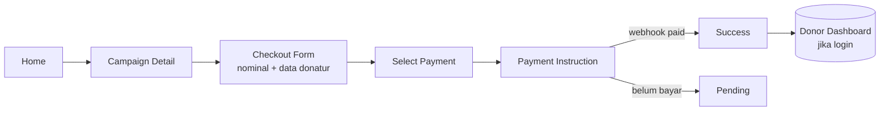

# Referensi User Journey — Amalsholeh.com

## J1. Donatur tamu berdonasi dari beranda (terverifikasi sampai pilih metode)

```mermaid
flowchart LR
  A[Beranda] -->|klik kartu program| B[Detail Program]
  B -->|Donasi Sekarang| C[Pilih Nominal]
  C -->|klik preset| D[Pilih Metode Pembayaran]
  C -->|isi custom ≥ Rp10.000 + Lanjutkan| D
  D -.->|[A] pilih metode| E[Form data donatur?]
  E -.-> F[Instruksi bayar]
  F -.-> G[Status / Terima kasih]
```

| Langkah | Layar | Status | Waktu interaksi |
|---|---|---|---|
| 1 | Beranda → kartu | [V] | 1 tap |
| 2 | Detail → "Donasi Sekarang" | [V] | 1 tap |
| 3 | Pilih nominal preset | [V] | 1 tap |
| 4 | Pilih metode | [V] layar terlihat | 1 tap |
| 5 | Data donatur, instruksi, status | [A] | — |

**Insight:** 3 tap dari beranda ke layar metode — target kita setara atau lebih baik, ditambah form data donatur minimal (nama opsional jika anonim, email wajib untuk kuitansi).

## J2. Donatur mencari program spesifik

Beranda → ikon cari → `/search` → ketik kata kunci → tab Program/Lembaga → detail. [V] Hasil muncul ±5 s.

## J3. Donatur ingin cek riwayat donasi

Bottom nav "Donasi Saya" → halaman ajakan unduh aplikasi. [V] **Journey terputus di web.**

## J4. Calon mitra membuka galang dana

Bottom nav/ikon "Galang Dana" → `/seru` → redirect `/login?redirect_url=/seru` [V] → (login) → form pengajuan [A] → verifikasi tim partnership [V dari halaman mitra] → buat program.

## J5. Donatur zakat

`/zakat` → kalkulator / pilih program zakat mitra (BAZNAS) [V] → alur donasi sama [A].

## Journey target Tebar Kebaikan (ringkas)


