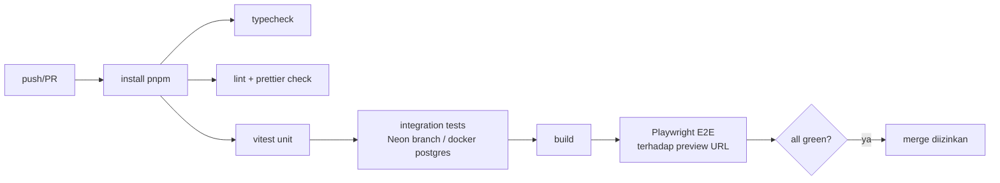

# Deployment

## Lingkungan

| Env | Git | Vercel | Neon | Upstash | Payment | Email/WA |
|---|---|---|---|---|---|---|
| development | lokal | `next dev` | branch `dev` | DB dev | Sandbox | Akun dev |
| preview | PR | Preview deployment | branch otomatis per PR (Neon–Vercel integration) | DB dev | Sandbox | Dinonaktifkan / sandbox only (`NOTIFICATIONS_ENABLED=false`) |
| production | `main` | Production | branch `main` | DB prod | Production | Akun produksi |

## Pipeline CI (GitHub Actions)

### Keamanan di CI (P25, T-48)
- `ci.yml`: `pnpm audit --prod --audit-level high` setelah install (gagal bila ada advisory high/critical di dependensi produksi) dan `pnpm check:bundle-secrets` setelah `pnpm build` — memindai `.next/static/**` + output prerender `.next/server/app/**` (html/rsc/segments) untuk **nama** secret (`SB-Mid-server`, `Mid-server`, `MIDTRANS_SERVER_KEY`, `GMAIL`, `FONNTE`, `DATABASE_URL`, `AUTH_SECRET`, `QSTASH_`, `APP_ENCRYPTION_KEY`, `UPSTASH_REDIS_REST_TOKEN`, `BLOB_READ_WRITE_TOKEN`, `VERCEL_AUTOMATION_BYPASS_SECRET`) dan **nilai** secret yang ada di environment build (dibandingkan sebagai byte, tidak pernah dicetak; nilai < 12 karakter diabaikan). Lokal: `pnpm build && pnpm check:bundle-secrets` (memuat `.env.local`).
- `gitleaks.yml`: setiap push & PR, gitleaks **8.30.1** (binary rilis resmi dipin + verifikasi SHA-256; `actions/checkout` dipin ke commit v4.2.2) memindai seluruh riwayat (`fetch-depth: 0`) dengan `.gitleaks.toml` (aturan bawaan + allowlist **per file + nilai persis** untuk 2 fixture palsu). Tidak butuh secret/lisensi. Disarankan dijadikan required check.
- **`APP_ENV` wajib diisi di Vercel** (P25 L8): Preview → `APP_ENV=preview`, Production → `APP_ENV=production`. Build/runtime gagal (validasi `env.ts`) bila kosong atau `development` saat `VERCEL_ENV` preview/production.
- Migrasi P25: `drizzle/0003_p25_hardening.sql` (`admin_users.totp_last_step`, `transactions.checkout_authenticated`, CHECK `campaigns.donor_count >= 0`) — sudah diterapkan ke Neon `dev` saja; preview/production saat rilis (`pnpm db:migrate`).
- Header keamanan (CSP, HSTS, dll.) tidak butuh konfigurasi Vercel; HSTS hanya terkirim bila `APP_ENV=production` dan `APP_URL` https.

### Lighthouse CI (P24)
Workflow terpisah `.github/workflows/lighthouse.yml` (pull request + manual), config `lighthouserc.cjs`: build produksi + `next start -p 3100` di runner, Lighthouse mobile 3× per URL (Home, Detail, Checkout), assert median: LCP ≤ 2500 ms, CLS ≤ 0,1, script ≤ 150 KB, audit SEO dasar (title, description, canonical, status, link, alt) pada halaman publik. `APP_ENV=development` (situs sengaja noindex → skor kategori SEO tidak di-assert; audit `is-crawlable` dikecualikan), notifikasi/WA off, tanpa Redis/QStash/Midtrans; `AUTH_SECRET` dibuat acak per run. Laporan diunggah sebagai artefak `lighthouse-reports`.

Secret yang harus ditambahkan PM (Settings → Secrets and variables → Actions):
| Nama | Isi |
|---|---|
| `LHCI_DATABASE_URL` | URL pooled Neon branch khusus CI (turunan `dev` berisi seed sample; **bukan production**). Disarankan role read-only. |
| `LHCI_DATABASE_URL_UNPOOLED` | URL unpooled branch yang sama |
| Variable `LHCI_CAMPAIGN_SLUG` (opsional) | slug campaign published di branch itu; default `contoh-renovasi-masjid-desa` |

Tanpa kedua secret, job **gagal** dengan anotasi error yang menjelaskan (bukan lulus kosong). Status P24: budget LCP & JS masih merah (lihat performance.md) — jangan jadikan required check sebelum diperbaiki/diputuskan PM (OD-25).

## Migrasi database
- `drizzle-kit generate` menghasilkan SQL yang di-commit; **tidak** memakai `push` di production.
- Migrasi dijalankan di step terpisah sebelum deploy produksi (`pnpm db:migrate` dengan `DATABASE_URL_UNPOOLED`), backward-compatible (expand → migrate → contract).
- Backup: buat Neon branch snapshot sebelum migrasi produksi.

## Langkah rilis
1. PR → CI hijau → review.
2. Merge `main` → GitHub Action jalankan migrasi prod → Vercel deploy production.
3. Smoke test otomatis (Playwright `@smoke`) terhadap production: home, campaign detail, checkout sampai Select Payment (tanpa bayar).
4. Verifikasi webhook endpoint dengan "Test notification" provider sandbox → hanya di env sandbox.
5. Catat di `docs/CHANGELOG.md`.

## Rollback
Vercel "Promote previous deployment"; migrasi bersifat additive sehingga kode lama tetap kompatibel; Neon point-in-time restore untuk kasus data.

## Domain
`tebarkebaikan.org` (contoh — open decision), `www` redirect ke apex, admin di `/admin` (opsional subdomain `admin.` dengan cookie terpisah).
