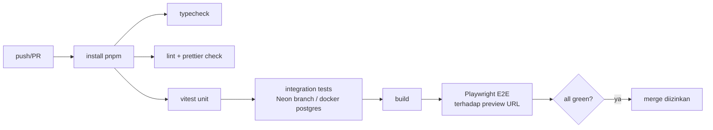

# Deployment

## Lingkungan

| Env | Git | Vercel | Neon | Upstash | Payment | Email/WA |
|---|---|---|---|---|---|---|
| development | lokal | `next dev` | branch `dev` | DB dev | Sandbox | Akun dev |
| preview | PR | Preview deployment | branch otomatis per PR (Neon–Vercel integration) | DB dev | Sandbox | Dinonaktifkan / sandbox only (`NOTIFICATIONS_ENABLED=false`) |
| production | `main` | Production | branch `main` | DB prod | Production | Akun produksi |

## Pipeline CI (GitHub Actions)

## Migrasi database
- `drizzle-kit generate` menghasilkan SQL yang di-commit; **tidak** memakai `push` di production.
- Migrasi dijalankan di step terpisah sebelum deploy produksi (`pnpm db:migrate` dengan `DATABASE_URL_UNPOOLED`), backward-compatible (expand → migrate → contract).
- Backup: buat Neon branch snapshot sebelum migrasi produksi.

## Langkah rilis
1. PR → CI hijau → review.
2. Merge `main` → GitHub Action jalankan migrasi prod → Vercel deploy production.
3. Smoke test otomatis (Playwright `@smoke`) terhadap production: home, campaign detail, checkout sampai Select Payment (tanpa bayar).
4. Verifikasi webhook endpoint dengan "Test notification" provider sandbox → hanya di env sandbox.
5. Catat di `docs/CHANGELOG.md`.

## Rollback
Vercel "Promote previous deployment"; migrasi bersifat additive sehingga kode lama tetap kompatibel; Neon point-in-time restore untuk kasus data.

## Domain
`tebarkebaikan.org` (contoh — open decision), `www` redirect ke apex, admin di `/admin` (opsional subdomain `admin.` dengan cookie terpisah).
