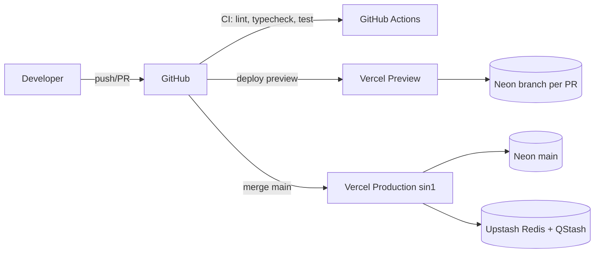

# Infrastructure

## Komponen

| Layanan | Kegunaan | Plan awal | Catatan |
|---|---|---|---|
| GitHub | Repo, PR, Actions CI | Free/Team | Branch protection `main` |
| Vercel | Hosting Next.js, preview per PR | Pro (disarankan untuk produksi komersial & limit fungsi) | Region fungsi `sin1` (Singapura) |
| Neon | PostgreSQL serverless | Launch | Region `aws-ap-southeast-1`; branch `main` (prod), `dev`, branch per PR |
| Upstash Redis | Cache, rate limit | Pay-as-you-go | Region `ap-southeast-1` |
| Upstash QStash | Job, schedule, retry | Pay-as-you-go | |
| Midtrans | Payment gateway (Core API) | Sandbox → Production | Butuh verifikasi merchant (legalitas lembaga) |
| Gmail SMTP | Email | Google Workspace (disarankan) | App Password, limit ±2.000/hari |
| Fonnte | WhatsApp | Paket sesuai volume | Nomor khusus notifikasi |
| Error tracking | Sentry | Free tier | Diputuskan OD-13 (10 Nov 2026); scrub PII/secret via `beforeSend` |
| Penyimpanan gambar | Vercel Blob | Sesuai pemakaian | Diputuskan OD-12 (10 Nov 2026) |

## Diagram deployment

## Jadwal QStash

| Job | Jadwal | Endpoint |
|---|---|---|
| Expire pending payments | */5 * * * * | `/api/jobs/expire-payments` |
| Cancel stale created transactions | 0 * * * * | `/api/jobs/cancel-stale` |
| Reconcile 48h | 0 18 * * * (UTC = 01:00 WIB) | `/api/jobs/reconcile` |
| Campaign scheduler (start/end) | */15 * * * * | `/api/jobs/campaign-scheduler` |
| Pending reminder (opsional, 1 jam sebelum expiry VA) | per-transaksi delay message | `/api/jobs/notify` |

## Estimasi biaya awal (indikatif, perlu cek harga terbaru)

Vercel Pro + Neon Launch + Upstash PAYG ≈ US$45–70/bulan di luar biaya transaksi payment gateway dan paket Fonnte.
