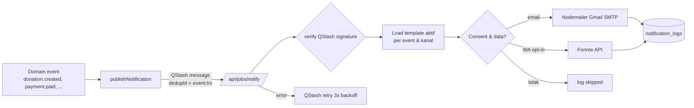

# Notification Architecture

## Alur

## Event → kanal

| Event | Email | WhatsApp |
|---|---|---|
| donation.created | ✅ (**nonaktif**, OD-10) | ✅ opt-in (**nonaktif**, OD-10) |
| payment.pending | ✅ (berisi instruksi) | ✅ |
| payment.paid | ✅ | ✅ |
| receipt.issued | ✅ (lampiran/link PDF) | ➖ |
| payment.failed | ✅ | ✅ (opsional) |
| payment.expired | ✅ | ➖ |
| account.welcome (login pertama) | ✅ | ➖ |

Catatan: `donation.created` dan `payment.pending` sering terjadi berdekatan; **diputuskan OD-10 (10 Nov 2026):** hanya **payment.pending** yang aktif agar tidak spam; template donation.created di-seed dengan `is_active = false`.

## Template
- Disimpan di `notification_templates` (event, channel, subject, body, is_active, version).
- Engine: substitusi `{{variable}}` sederhana dengan whitelist variabel (lihat daftar di master prompt); nilai di-escape HTML untuk email. Tidak ada logika/eksekusi kode dalam template.
- Email dibungkus layout HTML responsif bawaan (logo, footer, unsubscribe info untuk non-transaksional).
- Validasi simpan: semua `{{...}}` harus ada di whitelist.

## Pengiriman
- **Email:** Nodemailer transport `smtp.gmail.com:465` (secure) dengan `GMAIL_USER` + `GMAIL_APP_PASSWORD`; `from` = `EMAIL_FROM`. Pool koneksi dimatikan di serverless. Batas harian dipantau (counter Redis); bila mendekati limit → alert admin.
- **WhatsApp:** `POST https://api.fonnte.com/send` header `Authorization: FONNTE_TOKEN`, body `target`, `message`, `countryCode=62`. Respons disimpan (tanpa token).
- **Retry:** QStash `retries: 3`; job idempoten — sebelum kirim cek `notification_logs.dedup_key` berstatus `sent`.
- **Rate:** Fonnte dibatasi ≤ 1 pesan / 2 s per nomor pengirim (konfigurasi `FONNTE_MIN_DELAY_MS`) menggunakan QStash `delay`/flow control.

## Log
`notification_logs`: channel, recipient (disimpan penuh untuk kebutuhan kirim ulang; dimasking di UI), template_id, transaction_id, payload (variabel yang dirender — **tanpa** URL bertoken akses penuh; token diganti `***`), status (`queued/sent/failed/skipped`), provider_response, error_message, attempt, sent_at, dedup_key.

## Kegagalan
Kegagalan tidak memengaruhi status pembayaran (BR-31). Setelah 3 retry gagal → status `failed`, tampil di admin dengan tombol "Kirim ulang".

## Implementasi P16 (10 Nov 2026)
- Kode: `src/lib/notifications/{template,email-layout,jobs}.ts`, `src/lib/email/gmail.ts`, `src/server/services/notification-service.ts`, `src/server/services/notifications/{notify-handler,publish}.ts`, route `src/app/api/jobs/notify/route.ts`, repo `src/server/repositories/notification-repository.ts`.
- **Body job** (Zod, tanpa PII/token): `{event, transactionId, paymentId}` untuk `payment.pending|paid|failed|expired`; `{event:"receipt.issued", transactionId}` (no-op sampai P19); `{event:"admin.alert", kind: reconciliation|payment|email_quota, date?, ref?, alert?, paymentId?, transactionId?, counts?}`.
- **dedup_key** `notification_logs`: `{event}:{trx}:{channel}` untuk paid/expired/receipt (dipakai drain outbox §6a); `{event}:{trx}:{payment}:{channel}` untuk pending/failed (bisa per attempt, BR-17); `admin.alert:{kind}:{alert}:{ref|date}:email`. Dedup QStash: `payment-paid-{trx}`, `payment-pending-{payment}`, `reconcile-alert-{date}`, selain itu `{event}-{ref}`.
- **Satu baris log per kanal yang diharapkan**: email selalu; WhatsApp bila `whatsapp_opt_in` → saat ini `skipped` ("kanal WhatsApp belum diimplementasikan (P17)" / "WHATSAPP_ENABLED=false"). `NOTIFICATIONS_ENABLED=false` → semua `skipped` (tidak dikirim ulang setelah diaktifkan; gunakan "Kirim ulang" P23).
- **Lock per pesan** `notify:{event}:{ref}` (opsi `lockName` di `createJobHandler`); pesan kembar paralel → satu email.
- **Kegagalan**: SMTP error → baris `failed` (attempt+1, error = nama+kode saja) → 500 → QStash retry (3×). Kuota harian (Redis `tk:email:daily:{WIB date}`) terlampaui → `failed` tanpa retry; > 80% → `admin.alert` `email_quota` sekali per hari. Handler tidak pernah menulis `payments`/`transactions` (BR-31).
- **payment_url** = `/transaksi/{code}/menunggu` TANPA access token (token hanya tersimpan sebagai hash). Payload log tetap disaring: parameter token di URL → `***`.
- **Event dipublish**: `payment.pending` (createPayment), `payment.paid` (webhook/expiry/rekonsiliasi + outbox), `payment.failed`/`payment.expired` (webhook & job, hanya bila transaksi ikut terminal), `admin.alert`.
- **Alert admin via email**: hasil `applyVerifiedStatus` (`amount_mismatch`, `needs_review`, `paid_after_terminal`, `unknown_payment`, `refund_reported`) dari webhook & job (dedup per payment); `provider_auth`, `webhook_unverifiable` (dedup per jam); `provider_404_storm` (per tanggal); rekonsiliasi harian; kuota email. **Belum** dikirim via email (hanya log/audit): `orphan_charge` (createPayment) — tercakup laporan rekonsiliasi harian.
- Validasi simpan template untuk admin (P23): `validateTemplate()`.
