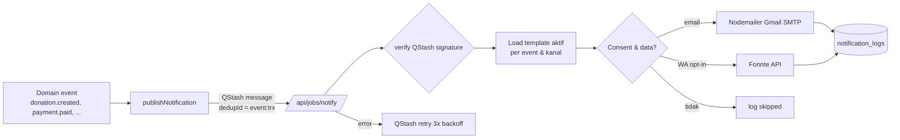

# Notification Architecture

## Alur

## Event → kanal

| Event | Email | WhatsApp |
|---|---|---|
| donation.created | ✅ (**nonaktif**, OD-10) | ✅ opt-in (**nonaktif**, OD-10) |
| payment.pending | ✅ (berisi instruksi) | ✅ |
| payment.paid | ✅ | ✅ |
| receipt.issued | ✅ (lampiran/link PDF) | ➖ |
| payment.failed | ✅ | ✅ (opsional) |
| payment.expired | ✅ | ➖ |
| account.welcome (login pertama) | ✅ | ➖ |

Catatan: `donation.created` dan `payment.pending` sering terjadi berdekatan; **diputuskan OD-10 (10 Nov 2026):** hanya **payment.pending** yang aktif agar tidak spam; template donation.created di-seed dengan `is_active = false`.

## Template
- Disimpan di `notification_templates` (event, channel, subject, body, is_active, version).
- Engine: substitusi `{{variable}}` sederhana dengan whitelist variabel (lihat daftar di master prompt); nilai di-escape HTML untuk email. Tidak ada logika/eksekusi kode dalam template.
- Email dibungkus layout HTML responsif bawaan (logo, footer, unsubscribe info untuk non-transaksional).
- Validasi simpan: semua `{{...}}` harus ada di whitelist.

## Pengiriman
- **Email:** Nodemailer transport `smtp.gmail.com:465` (secure) dengan `GMAIL_USER` + `GMAIL_APP_PASSWORD`; `from` = `EMAIL_FROM`. Pool koneksi dimatikan di serverless. Batas harian dipantau (counter Redis); bila mendekati limit → alert admin.
- **WhatsApp:** `POST https://api.fonnte.com/send` header `Authorization: FONNTE_TOKEN`, body `target`, `message`, `countryCode=62`. Respons disimpan (tanpa token).
- **Retry:** QStash `retries: 3`; job idempoten — sebelum kirim cek `notification_logs.dedup_key` berstatus `sent`.
- **Rate:** Fonnte dibatasi ≤ 1 pesan / 2 s per nomor pengirim (konfigurasi `FONNTE_MIN_DELAY_MS`) menggunakan QStash `delay`/flow control.

## Log
`notification_logs`: channel, recipient (disimpan penuh untuk kebutuhan kirim ulang; dimasking di UI), template_id, transaction_id, payload (variabel yang dirender — **tanpa** URL bertoken akses penuh; token diganti `***`), status (`queued/sent/failed/skipped`), provider_response, error_message, attempt, sent_at, dedup_key.

## Kegagalan
Kegagalan tidak memengaruhi status pembayaran (BR-31). Setelah 3 retry gagal → status `failed`, tampil di admin dengan tombol "Kirim ulang".
