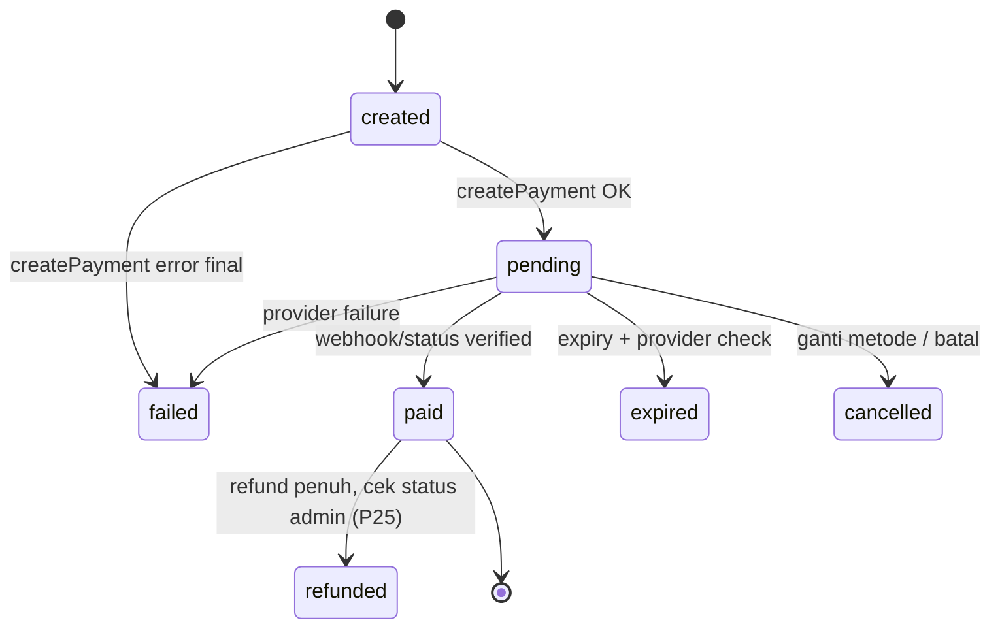

# Payment Architecture

> **Keputusan 10 Nov 2026 (OD-03):** MVP hanya memakai **Midtrans Core API**. Interface `PaymentProvider` tetap dibangun agar provider lain bisa ditambahkan tanpa mengubah alur checkout; bagian Xendit di bawah menjadi referensi untuk fase berikutnya dan **tidak diimplementasikan** di MVP. Fallback antar-provider (BR-16) nonaktif.

## 1. Prinsip
1. Status bayar hanya dari **webhook terverifikasi** atau **query status ke API provider**.
2. Semua pemrosesan **idempoten**; total campaign bertambah sekali per transaksi.
3. Setiap interaksi provider dicatat di `payment_events`.
4. Secret hanya di server (`MIDTRANS_SERVER_KEY`).
5. Hanya metode yang benar-benar didukung provider aktif yang ditampilkan.

## 2. Interface

```ts
// src/lib/payments/types.ts
export type ProviderCode = 'midtrans'; // tambah 'xendit' bila OD-03 dibuka kembali
export type MethodType = 'qris' | 'ewallet' | 'virtual_account' | 'retail' | 'card';
export type PaymentStatus = 'created' | 'pending' | 'paid' | 'expired' | 'failed' | 'cancelled' | 'refunded';

export interface CreatePaymentInput {
  paymentId: string;          // UUID internal → idempotency key / order_id
  transactionCode: string;
  amount: bigint;             // rupiah
  method: { code: string; type: MethodType; providerChannel: string }; // mis. 'bca_va', 'gopay', 'qris'
  customer: { name: string; email: string; phone?: string };
  description: string;
  expiresInMinutes: number;
  successRedirectUrl: string; // hanya untuk UX, bukan bukti bayar
}

export interface PaymentInstruction {
  kind: 'virtual_account' | 'qr' | 'redirect' | 'payment_code';
  bankName?: string;
  vaNumber?: string;
  qrString?: string;          // dirender jadi gambar QR di server/client
  qrImageUrl?: string;
  paymentUrl?: string;        // deeplink / checkout URL e-wallet
  paymentCode?: string;
  billerCode?: string;        // Mandiri Bill (echannel)
  billKey?: string;
  expiresAt: Date;
  raw?: Record<string, unknown>; // ter-redaksi
}

export interface CreatePaymentResult { providerRef: string; status: PaymentStatus; instruction: PaymentInstruction; }
export interface StatusResult { providerRef: string; status: PaymentStatus; paidAmount?: bigint; paidAt?: Date; needsReview?: boolean; raw: unknown; }
export interface VerifiedWebhook { eventId: string; providerRef: string; orderId: string; status: PaymentStatus; amount: bigint; paidAt?: Date; needsReview?: boolean; raw: unknown; }

export interface PaymentProvider {
  readonly code: ProviderCode;
  createPayment(input: CreatePaymentInput): Promise<CreatePaymentResult>;
  getPaymentStatus(ref: { providerRef: string; orderId: string }): Promise<StatusResult>;
  verifyWebhook(req: { headers: Headers; rawBody: string }): Promise<VerifiedWebhook>; // throw bila tidak valid
  getPaymentInstructions(payment: { providerRef: string; instruction: PaymentInstruction }): PaymentInstruction;
  expirePayment(ref: { providerRef: string; orderId: string }): Promise<void>;
}
```

Registry: `getProvider(code)` membaca konfigurasi env; provider tanpa kredensial dianggap **tidak terkonfigurasi** dan metodenya tidak tampil.

## 3. Adapter

> Endpoint & field persis **wajib diverifikasi ulang** terhadap dokumentasi resmi saat Development Step 5 (API provider berevolusi).

### Midtrans (Core API)
| Fungsi | Implementasi |
|---|---|
| createPayment | `POST {base}/v2/charge` dengan `payment_type` (`bank_transfer`, `qris`, `gopay`, `shopeepay`, `echannel` untuk Mandiri), `transaction_details.order_id = payment.id`, `gross_amount`, `custom_expiry` |
| getPaymentStatus | `GET {base}/v2/{order_id}/status` |
| verifyWebhook | `signature_key == SHA512(order_id + status_code + gross_amount + SERVER_KEY)`; lalu **cross-check** `getPaymentStatus` |
| expirePayment | `POST {base}/v2/{order_id}/expire` (407 = berhasil; 404/412 = sudah final → cek status) |
| Mapping status | `settlement`/`capture(accept)` → paid; `capture(challenge)` → pending + `needsReview`; `capture(deny)`/`deny`/`failure` → failed; `pending` → pending; `expire` → expired; `cancel` → cancelled; `refund` → refunded (`needsReview`; diterapkan + total dikurangi hanya via cek status admin, P25); `partial_refund` → refunded + `partialRefund` (tidak diterapkan, `needs_review`); lainnya (`authorize`, `chargeback`, …) → error `unmapped_status` (tidak diterapkan) |
| Base URL | sandbox `https://api.sandbox.midtrans.com`, prod `https://api.midtrans.com` |

### 3a. Implementasi Midtrans (P10, T-23) — `src/lib/payments/midtrans/`
- `mapping.ts` (murni): kanal → `payment_type`, body charge, normalisasi instruksi, pemetaan status, `gross_amount` → bigint (pecahan ditolak), signature SHA512 + `timingSafeEqual`. `provider.ts`: `createMidtransProvider({serverKey, isProduction, recordEvent, fetch?, now?, timeoutMs?})`. `event-log.ts`: sink `payment_events` (`create_request`/`create_error`/`status_check`/`expire_request`, `provider_event_id` NULL, `payment_id` hanya bila baris `payments` ada). `redact.ts`: header tidak pernah disimpan; kunci `authorization|server_key|signature_key|token|password|secret` → `[REDACTED]`, email/phone/first_name/last_name disamarkan (nama kunci case-insensitive), literal server key diganti. `errors.ts`: `MidtransError{code,userMessage,retryable}` (pesan ramah donatur).
- HTTP: Basic `base64(SERVER_KEY + ":")`, timeout 10 s (`AbortSignal.timeout`, termasuk saat membaca body → `timeout`/`network`). **POST (charge/expire) tidak pernah di-retry.** GET di-retry 1× hanya bila `fetch` melempar sebelum ada respons (jaringan/timeout); 4xx/5xx ber-body tidak pernah di-retry.
- Pemulihan charge: error jaringan/timeout atau 406 `duplicate_order` → `GET status`. Pending + nominal sama + instruksi lengkap → kembalikan instruksi charge yang sudah ada; transaksi tidak ada → error asli (boleh dicoba lagi); status lain/instruksi tak lengkap → `duplicate_order`; nominal beda → `invalid_response`. Pemulihan expire: error jaringan → cek status; bukan pending = selesai.
- `order_id`: milik kita (`createPayment`, `getPaymentStatus`, `expirePayment`) wajib UUID; `order_id` notifikasi wajib `^[A-Za-z0-9._~-]{1,50}$` dan bukan `.`/`..` (aman untuk path). `event-log.ts` hanya menautkan `payment_id` bila `order_id` UUID valid (perbandingan `uuid`, tanpa cast `::text`). Hasil ditentukan dari `status_code` di body (Midtrans membalas HTTP 200 untuk error, terverifikasi di sandbox).
- `createPayment` memvalidasi respons: `order_id` & `gross_amount` sama dengan request, `transaction_id` ada, status `pending`. `expiresAt` = `expiry_time` respons (WIB) atau fallback `now + expiry_minutes`.
- `verifyWebhook`: Zod → signature (dengan `gross_amount` string persis) → `GET status` → status, nominal, `paidAt` **dari API**; `transaction_id` notifikasi harus sama dengan API. `eventId = transaction_id:transaction_status:status_code` (dipisah `:`). Hanya `VerifiedWebhook`/`StatusResult` ini yang boleh masuk `applyVerifiedStatus` (M2).
- QR: dari `qr_string` saja; URL `generate-qr-code` Midtrans tidak pernah dipakai/disimpan di instruksi. GoPay tanpa `qr_string` → `kind: redirect` (deeplink).
- Env guard (`env.ts`): selain `APP_ENV=production`, `MIDTRANS_IS_PRODUCTION` wajib false; `APP_ENV=production` mewajibkan `MIDTRANS_IS_PRODUCTION=true` (tanpa pengecualian staging); mode sandbox mewajibkan prefix `SB-Mid-server-`/`SB-Mid-client-`; mode production menolak kunci `SB-`.

#### Perbedaan dokumentasi resmi Midtrans vs catatan playbook (dicek 10 Nov 2026; docs resmi menang)
1. **Permata VA**: integrasi resmi memakai `payment_type: "permata"` tanpa objek `bank_transfer` ([Bank Transfer](https://docs.midtrans.com/docs/coreapi-core-api-bank-transfer-integration)); playbook: `bank_transfer` + bank `permata`. Adapter memakai `"permata"`. Sandbox menerima keduanya dan membalas `payment_type: "bank_transfer"` + `permata_va_number`.
2. **Mandiri Bill**: tabel atribut docs menyebut `bill_key` = "company code" dan `biller_code` = "bill number", tetapi contoh respons (dan respons sandbox nyata: `biller_code "70012"`, `bill_key` 12 digit) menunjukkan sebaliknya. Adapter: `billerCode` = kode perusahaan, `billKey` = kode bayar. `bill_info1` ≤10 karakter, `bill_info2` ≤30 (dipotong Mandiri).
3. **Expire**: sukses = `status_code "407"` ("Success, transaction has expired"), bukan 200 ([Expire](https://docs.midtrans.com/reference/expire-transaction)). 412 = merchant tidak boleh mengubah status; 404 tidak didokumentasikan di halaman itu tetapi sandbox mengembalikan `status_code "404"` (HTTP 200). Tidak ada fallback `cancel`.
4. **Get Status 404**: dikembalikan sebagai HTTP 200 dengan body `status_code "404"` ([Get Status](https://docs.midtrans.com/reference/get-transaction-status); terverifikasi sandbox). Semua hasil dibaca dari body.
5. **QR GoPay**: docs [GoPay](https://docs.midtrans.com/docs/coreapi-e-money-integration) menyarankan *hotlink* URL `generate-qr-code`; kebijakan kita tetap tidak memuat gambar dari domain Midtrans (QR hanya dari `qr_string`; GoPay → deeplink).
6. **Batas expiry**: ShopeePay & QRIS default 5 menit (dokumen lain: 15 menit), min 20 detik, maks 5 hari; GoPay maks 7 hari ([ShopeePay & QRIS](https://docs.midtrans.com/reference/shopeepay), [Charge](https://docs.midtrans.com/reference/charge-transactions-1)). Seed 15 menit aman; `custom_expiry` melebihi batas ditolak Midtrans.
7. **Status notifikasi**: halaman [HTTP Notification](https://docs.midtrans.com/docs/https-notification-webhooks) juga mendefinisikan `authorize` (kartu) dan tidak mendefinisikan `chargeback` → dipetakan ke error `unmapped_status`. `capture + deny` → failed (playbook tidak menyebut).
8. **Kode error tambahan**: 402 "Payment channel is not activated" dan (GoPay) 404 "Merchant pop id is not found" pada charge — dipetakan ke `channel_unavailable` ("Metode pembayaran ini sedang tidak tersedia…"); 406 = order_id duplikat; 429 = rate limit.
9. **QRIS `acquirer`**: halaman QRIS Core API tidak dapat diakses (404) saat dicek; adapter mengirim `qris.acquirer = "gopay"` sesuai playbook — verifikasi saat QRIS aktif di sandbox.
10. **Retry webhook Midtrans**: 2xx tanpa retry; 500 → 1×, 503 → 4×, 400/404 → 2×, lainnya hingga 5× (≈2/10/30/90/210 menit). Relevan untuk P13 (balas 200 untuk event duplikat/anomali yang sudah dicatat).

#### Temuan uji E2E sandbox preview (P15, T-27, 10 Nov 2026)
Suite: `tests/e2e/payments.sandbox.spec.ts` (tag `@sandbox`, hanya berjalan bila `SANDBOX_BASE_URL` diisi; project Playwright `sandbox`, header `x-vercel-protection-bypass` dari env — browser Simulator memakai context terpisah tanpa header itu dan suite gagal bila header bocor ke Midtrans).
1. **Deployment Protection memblokir notifikasi Midtrans.** Log request Vercel: POST `Veritrans` ke `/api/webhooks/midtrans` dibalas **401 oleh edge Vercel** (tidak sampai fungsi, tanpa baris `payment_events`), sehingga transaksi tetap `pending` walau Midtrans `settlement`. Query `?x-vercel-protection-bypass=<secret>` **berfungsi** (diuji: 400 dari aplikasi untuk body kosong); menambah `x-vercel-set-bypass-cookie=true` menghasilkan **307** (Midtrans tidak mengikuti redirect POST) — jangan dipakai. Notification URL dashboard sandbox wajib persis `https://<preview>/api/webhooks/midtrans?x-vercel-protection-bypass=<secret>` (secret saat ini). Midtrans tetap mencoba ulang sesuai §3a #10; charge yang sudah `settlement` juga ditangkap `reconcile` harian (`provider_paid_db_pending`).
2. **GoPay**: charge sandbox → `status_code 404` "Merchant pop id is not found" (bukan 402) — sesuai §3a #8. **QRIS/ShopeePay/BRI/CIMB**: `402` "Payment channel is not activated".
3. **`order_id` > 50 karakter** → `400` "One or more parameters in the payload is invalid" (HTTP 200). UUIDv7 kita (36) aman.
4. **Simulator**: VA BCA `/bca/va/index` (field `va_number`), Permata `/openapi/va/index?bank=permata`, Mandiri Bill `/openapi/va/index?bank=mandiri` (`billerCode` + `billKey`; `vaNumber` dihitung JS saat `change`), alur *Inquire* → *Pay* → "Simulated payment is successful". Status API langsung `settlement` setelah *Pay*.
5. **Expire**: setelah `expire_request` (407), Get Status melaporkan `transaction_status: "expire"` — sesuai §3a #3. Ganti metode: charge lama `expire` di Midtrans, payment lama `cancelled` di DB.
7. **Setelah Notification URL diperbaiki (re-run P15)**: Midtrans mengirim notifikasi `pending` segera setelah charge → `duplicate` (payment sudah `pending` dari createPayment), lalu `settlement` → `processed` (paid) dalam ±10 s setelah *Pay* di Simulator. Notifikasi untuk charge yang kita expire/cancel: `expire` → `duplicate` (payment `expired`) atau `ignored_transition` (payment `cancelled`). Retry Midtrans untuk notifikasi yang sebelumnya 401 di edge Vercel **tidak** terlihat dalam ±1 jam — charge tersebut menunggu `reconcile`.
6. **QStash → preview**: schedule `tk-preview-*` dan `publishJob` (hanya `APP_ENV=preview`) membawa header `x-vercel-protection-bypass` (diteruskan QStash sebagai `Upstash-Forward-*`); tanpa itu job terjadwal dibalas 401 oleh Vercel. Tidak pernah di production.

### 3b. Select Payment & createPayment (P11, T-20/T-25) — `src/server/services/payment-service.ts`
- Daftar metode: `payment_methods` aktif × `payment_providers.is_enabled` × provider terkonfigurasi env (`isProviderConfigured`). Cache Redis `tk:cache:payment-methods:active:v1` TTL 5 menit (dev tanpa Upstash → DB langsung); admin (P22) wajib memanggil `invalidatePaymentMethodsCache()` setelah mengubah metode/provider. Grup QRIS / E-Wallet / Virtual Account (Mandiri Bill masuk VA); metode yang `min_amount`/`max_amount`-nya tidak mencakup nominal disembunyikan (`src/lib/payments/method-groups.ts`). Saat membuat pembayaran metode dibaca segar dari DB (bukan cache).
- `createPaymentForTransaction`: Zod → token (hash) + slug → transaksi `created|pending` → lock Redis `tk:lock:payment:{trxId}` 60 s (menutup expire 10 s + charge 10 s + pemulihan Get Status + margin; fallback in-memory hanya dev; Redis error → **fail-closed** di preview/production (pesan "coba lagi"), lanjut hanya di development; indeks `payments_one_active_per_tx_idx` (`status IN ('pending','paid')`, migrasi 0001) sebagai cadangan) → payment pending metode sama dengan sisa > 60 s dipakai ulang → insert payment `created` (UUIDv7 = order_id) → payment pending metode lain: `provider.expirePayment` dulu (gagal → berhenti, payment lama tetap sah), lalu **langsung** `pending→cancelled` di DB agar charge mati tidak pernah dipakai ulang di jalur gagal mana pun → `provider.createPayment` → **satu transaksi DB** (`FOR UPDATE` transaksi): lama `pending→cancelled`, baru `created→pending` (+provider_ref, instruction, expires_at), transaksi `pending`. Transaksi tidak pernah terlihat `cancelled`.
- Gagal provider: payment baru `failed`, pesan `MidtransError.userMessage`, transaksi tetap `created`/`pending` (bisa dicoba lagi). `failure_reason` & log hanya berisi kode (`midtrans:<code>[:status]`, `db:<sqlstate>`, atau nama kelas error) — tidak pernah body request/PII.
- Aktivasi gagal (indeks satu-aktif, transaksi sudah paid, error DB) setelah charge baru dibuat → payment baru `failed` (provider_ref disimpan bila tidak bentrok) + charge di-expire ke provider. Bila expire itu gagal: log error (paymentId, providerRef) + audit `payment.orphan_charge` (actor system, metadata transactionId/paymentId/providerRef/cause). **Rekonsiliasi P14 wajib mencakup payment `failed` yang punya provider_ref dan audit `payment.orphan_charge`** (charge bisa dibayar → alert P16).
- Placeholder instruksi memakai DTO minimal (kode, nominal, status, judul program; tanpa data donatur) — dilengkapi di P12 (§3c).
- Setelah sukses: QStash `payment.pending` ke `/api/jobs/notify` (dedup `payment-pending-{paymentId}`, handler P16). Tanpa `QSTASH_TOKEN` hanya di `APP_ENV=development` → log & lewati. Redirect `/transaksi/{code}/instruksi?t=` (placeholder; P12). `successRedirectUrl` ke provider = `/transaksi/{code}/menunggu` **tanpa** token (diubah di P12, lihat §3c).

### 3c. Instruksi, Berhasil, Menunggu & endpoint status (P12, T-21)
- Halaman `/transaksi/{code}/instruksi|berhasil|menunggu?t=` dan `GET /api/transactions/{code}/status?t=` hanya **membaca** DB (`getTransactionView`/`getTransactionStatus` di `payment-service.ts`): tidak memanggil Midtrans dan tidak mengubah status (BR-18). Token salah/kedaluwarsa → 404 (proxy + halaman/route). Semua halaman ber-token: `noindex` + `referrer: no-referrer`.
- DTO `TransactionView`: kode, nominal (bigint), status, judul & slug program, waktu dibuat/dibayar, metode (nama, tipe), `expiresAt`, detail instruksi yang disaring (`bankName`, `vaNumber`, `billerCode`, `billKey`, `qrString`, `paymentUrl` hanya skema `https://`/`gojek://`/`shopeeid://`) dan langkah bayar. **Tanpa** email/telepon/nama donatur, id internal, `raw` provider, atau URL gambar QR.
- Payment yang ditampilkan: aktif (`pending`/`paid`) bila ada, selain itu payment terakhir non-`created` (state kedaluwarsa/gagal). `pending` dengan `expires_at` lewat ditampilkan sebagai kedaluwarsa (tampilan saja; status DB diubah job P14).
- Langkah bayar: `payment_methods.instructions` divalidasi Zod (`src/lib/payments/instruction-template.ts`), placeholder `{{va_number}}` (Mandiri Bill: kode bayar), `{{amount}}`, `{{bank_name}}`; placeholder lain → `-`; karakter kontrol/bidi dibuang; dirender sebagai teks React (tidak pernah HTML).
- QR (QRIS & GoPay desktop bila respons memuat `qr_string`): PNG data URL dibuat di server dengan `qrcode` (`src/lib/payments/qr.ts`) + tombol unduh. GoPay/ShopeePay: tombol deeplink.
- Polling: `StatusPoller` tiap 5 s maks 10 menit (AC-08.1) lalu tombol "Cek status"; `paid` → `berhasil`, status akhir lain → muat ulang data server. Hook uji `window.__TK_POLL__` hanya dihormati bila `APP_ENV ≠ production`. Endpoint: Zod (kode + token 43 char), rate limit `trx-status` 30/menit per IP+kode (fallback in-memory hanya development; Redis error → fail-open OD-15), respons `{status, paidAt}` saja, `Cache-Control: no-store`.
- `berhasil` hanya bila status DB `paid`; query string apa pun diabaikan, selain itu redirect ke `menunggu` (AC-07.1). Tombol kuitansi aktif sejak P19 (route tamu bertoken, §5c); ajakan masuk Google untuk pengunjung tanpa sesi donor.
- **Callback e-wallet (keputusan P12):** `callback_url` GoPay/ShopeePay = `/transaksi/{code}/menunggu` **tanpa** access token. Opsi memasukkan `?t=` ke callback ditolak: URL itu disimpan Midtrans, muncul di log/dashboard provider dan aplikasi e-wallet, dan bisa bocor lewat riwayat/Referer — siapa pun yang memegangnya bisa melihat transaksi selama 7 hari. Sebagai gantinya proxy mengizinkan `/transaksi/{code}/menunggu` **tanpa** `?t=` (kode harus berformat TK; tanpa query DB) dan halaman menampilkan pesan generik "Pembayaran sedang diproses" tanpa data transaksi apa pun + ajakan membuka tautan dari email. Bila `?t=` ada tetapi salah → 404. Trade-off: setelah kembali dari aplikasi e-wallet, donatur tidak langsung melihat status (harus membuka tautan email/tab instruksi yang masih terbuka, yang terus polling).
- Logger (`src/lib/logger.ts`) meredaksi nilai `t|token|access_token|code_verifier` di URL/query (termasuk bentuk ter-encode `%3Ft%3D`) pada `msg` dan semua field string (bertingkat). Belum ada analytics di aplikasi; saat ditambahkan (AC-07.4) URL halaman transaksi wajib dikirim tanpa query string.

### Xendit (referensi — ditunda, tidak diimplementasikan di MVP)
| Fungsi | Implementasi |
|---|---|
| createPayment | Payments/Payment Request API (versi dipilih saat implementasi) dengan `reference_id = payment.id`, header `Idempotency-key = payment.id`, channel VA/QRIS/e-wallet |
| getPaymentStatus | GET payment request by id |
| verifyWebhook | header `x-callback-token` dibandingkan `XENDIT_WEBHOOK_TOKEN` (timing-safe), lalu cross-check status via API |
| expirePayment | endpoint expire/cancel sesuai channel bila tersedia; bila tidak, cek status dan tandai lokal setelah dipastikan belum dibayar |
| Mapping status | `SUCCEEDED` → paid; `PENDING`/`REQUIRES_ACTION` → pending; `EXPIRED` → expired; `FAILED` → failed; `CANCELED` → cancelled |

## 4. State machine



Status **transaksi** diturunkan dari payment aktif: `created` (belum ada payment), `pending`, `paid`, `expired`, `failed`, `cancelled`, `refunded`.

## 5. Pemrosesan webhook (pseudocode)

```ts
POST /api/webhooks/[provider]
  raw = await req.text()
  event = insert payment_events {provider, raw(redacted), received_at, verification:'pending'}
  try verified = provider.verifyWebhook({headers, raw})
  catch → update event 'rejected'; return 401
  if exists payment_events(provider, event_id=verified.eventId, processed=true) → return 200   // dedup
  db.transaction(async tx => {
    p = SELECT * FROM payments WHERE id = verified.orderId FOR UPDATE
    if !p → mark 'unknown_payment'; return
    if verified.amount !== p.amount → mark 'amount_mismatch'; alert; return
    if !canTransition(p.status, verified.status) → mark 'ignored_transition'; return
    UPDATE payments SET status, paid_at, provider_ref ...
    if verified.status === 'paid':
       updated = UPDATE transactions SET status='paid', paid_at=now(), receipt_no=nextval(...)
                 WHERE id=p.transaction_id AND status <> 'paid' RETURNING *
       if updated: UPDATE campaigns SET collected_amount += amount, donor_count += 1 WHERE id = ...
    mark event processed
  })
  publish QStash notify(event, transactionId)   // dedup key = event:trx:channel
  revalidateTag(`campaign:${slug}`)
  return 200
```

Kunci idempotensi:
- `payment_events UNIQUE(provider_id, provider_event_id)`
- `payments UNIQUE(provider_id, provider_ref)`
- Guard `WHERE status <> 'paid'` + `SELECT ... FOR UPDATE`
- `notification_logs UNIQUE(dedup_key)`

### 5a. Implementasi (P09, T-22) — `src/lib/payments/apply-verified-status.ts`
- `applyVerifiedStatus(tx, {paymentId, status, amount, paidAt, source, eventId, providerRef?})` dipanggil di dalam `getTxDb().transaction()` (driver WebSocket Pool; HTTP driver tidak mendukung transaksi interaktif). `source` ∈ `webhook | expiry_job | reconcile | admin_check`. `eventId` = `payment_events.id` milik event webhook (opsional).
- Urutan: `SELECT ... FROM payments WHERE id = $1 FOR UPDATE` → unknown → nominal (`paid` tanpa nominal juga dianggap `amount_mismatch`) → status sama = `duplicate` → `canTransition` → `UPDATE payments` → turunkan status transaksi.
- `paid`: `UPDATE transactions SET status='paid' ... WHERE id=$1 AND status NOT IN ('paid','refunded') RETURNING` (guard BR-19 diperluas agar transaksi `refunded` tidak kembali paid). Hanya bila baris kembali: `campaigns` += amount/1 dan nomor kuitansi `KW/YYYY/NNNNNN` dari `INSERT INTO receipt_counters ... ON CONFLICT (year) DO UPDATE SET last_seq = last_seq + 1 RETURNING last_seq` (YYYY = tahun `paid_at` Asia/Jakarta; upsert agar tahun baru tidak gagal).
- **Refund (P25, OD-28):** `refund` dari Get Status hanya diterapkan untuk `source = admin_check` (sumber lain → `ignored_transition` + alert). Midtrans `partial_refund` dipetakan `refunded` + `partialRefund` → **tidak diterapkan** (`ignored_transition`, audit `payment.needs_review`, alert `refund_reported`) karena sistem tidak punya nominal refund parsial. Refund penuh: `UPDATE transactions SET status='refunded' WHERE id=$1 AND status='paid' RETURNING amount, campaign_id`; hanya bila baris kembali → `UPDATE campaigns SET collected_amount = collected_amount - amount, donor_count = donor_count - 1` + audit `campaign.total_reversed` (aktor system, metadata amount/sumber). Baris payment terkunci `FOR UPDATE`, jadi pemanggilan paralel → satu pengurangan; CHECK `collected_amount >= 0`/`donor_count >= 0` (migrasi 0003) menggagalkan transaksi bila data tidak konsisten. Kuitansi yang sudah terbit tidak dihapus (BR-28).
- Status non-paid diturunkan ke transaksi hanya bila transisi transaksi legal (`TRANSACTION_TRANSITIONS`) dan tidak ada attempt lain yang `pending/paid`. Transaksi boleh `expired/failed/cancelled → pending` (attempt baru, BR-11).
- **Anomali** (tidak melempar; ikut ter-commit): `payment_events.result` (`unknown_payment`, `amount_mismatch`, `ignored_transition`) — update event webhook bila `eventId` ada, selain itu baris baru `event_type = internal.<source>`; plus `audit_logs` (actor `system`, entity `payment`) aksi `payment.amount_mismatch`, `payment.unknown_payment`, `payment.ignored_transition`, `payment.needs_review` (uang masuk ke payment yang sudah expired/cancelled atau transaksi sudah paid lewat payment lain — BR-17), dan log JSON terstruktur.
- **Alert admin internal:** hasil fungsi berisi `alert` (`amount_mismatch | paid_after_terminal | unknown_payment | refund_reported | needs_review`). Pengiriman email admin belum ada (P16): P16 mengirim `alert` ini ke `EMAIL_ADMIN_ALERT` setelah commit dan dapat memindai `audit_logs` aksi `payment.*` sebagai cadangan.
- Hasil `{outcome, changed, becamePaid, newStatus, transactionStatus, campaignId, receiptNo, alert}`; notifikasi & `revalidateTag` hanya bila `becamePaid`, di luar transaksi DB.
- Registry (`registry.ts`): `getProvider(code)` → `null` bila env (`MIDTRANS_SERVER_KEY` + `MIDTRANS_CLIENT_KEY`) tidak lengkap (slot Midtrans diisi `createMidtransFromEnv` di P10). Tidak ada provider palsu di `src/`; `FakeProvider` hanya di `tests/support/`.

### 5b. Implementasi webhook (P13, T-24) — `POST /api/webhooks/midtrans`
File: `src/app/api/webhooks/midtrans/route.ts` (runtime `nodejs`, tipis), `src/lib/payments/webhook/midtrans-webhook.ts` (alur), `src/lib/payments/webhook/side-effects.ts` (QStash + revalidate).

Alur:
1. `Content-Type` harus `application/json` (415); body dibaca dengan batas **16 KB** (stream, tidak hanya `Content-Length`; 413); JSON + Zod bentuk minimum (`order_id`, `transaction_id`, `transaction_status`, `status_code`, `gross_amount`, `signature_key`) → 400 tanpa disimpan (hanya path field yang salah yang dilog).
1b. **Signature lokal dulu** (`provider.checkWebhookSignature`: Zod ketat + SHA512 timing-safe, sinkron, tanpa I/O). Salah → **401**, hanya log warn, **tanpa baris DB** dan tanpa panggilan Midtrans. Setiap penolakan menghitung rate limit per IP (`webhook-reject` 20/menit, Upstash; fallback in-memory hanya development; Redis error → fail-open) → lewat batas **429**.
2. Insert `payment_events` (`event_type = notification`, `verification = pending`, `result = received`, payload ter-redaksi `redactPayload` — `signature_key` → `[REDACTED]`, PII disamarkan; header tidak disimpan; `payment_id` hanya bila baris payments ada).
3. `provider.verifyWebhook` (SHA512 timing-safe → Get Status). Hasil:
   - `invalid_signature` (cadangan; normalnya sudah tertolak di 1b) → `rejected`, **401**.
   - Get Status `404` (order tak dikenal Midtrans, mis. tombol *Test notification* dashboard) → `verified` + `unknown_payment`, **200**.
   - Gangguan sementara (`network`, `timeout`, `provider_unavailable`, `rate_limited`, `unauthorized`/kunci salah, error non-Midtrans) → `result = error`, verification tetap `pending`, **503**. Get Status 401/403 juga memancarkan log `payment.alert` kind `provider_auth` (server key salah/dicabut).
   - Permanen lain (`unmapped_status` mis. `chargeback`/`authorize`, `transaction_id` ≠ API, respons tak valid) → `rejected` + audit `payment.webhook_unverifiable` (actor `provider`, entity `payment_event`) + log `payment.alert`, **200** (retry tidak membantu; rekonsiliasi P14 tetap memeriksa).
4. **Satu transaksi DB**: `UPDATE payment_events SET provider_event_id = verified.eventId, verification = 'verified'` (klaim pada `UNIQUE(provider_id, provider_event_id)`) lalu `applyVerifiedStatus(tx, {source:'webhook', eventId: <id baris event>, needsReview, …})` — data hanya dari `VerifiedWebhook` (M2). Request paralel dengan eventId sama menunggu di indeks unik: bila pemenang commit → `23505` **pada constraint `payment_events_provider_event_key`** (dicek lewat nama constraint; unique violation lain → 503) → baris ini ditandai `duplicate`, **200**; bila pemenang rollback, klaim berikutnya berhasil (event tidak pernah "hilang" karena dedup). Error DB lain → rollback, `result = error`, **503**.
5. Hasil di `payment_events.result`: `processed` / `duplicate` / `ignored_transition` / `amount_mismatch` / `unknown_payment` (ditulis `applyVerifiedStatus`). *needs_review* bukan nilai enum: dicatat sebagai audit `payment.needs_review` + `alert` (refund → `ignored_transition` + `refund_reported`; settlement setelah expired/cancelled → `ignored_transition` + `paid_after_terminal`; capture+challenge → `processed`/`duplicate` + `needs_review`).
5b. **Outbox:** bila `becamePaid`, di transaksi yang sama ditulis `audit_logs` `notification.pending` (actor system, entity `transaction`, metadata `{event:'payment.paid', paymentId}`). Publish QStash setelah commit bisa gagal tanpa kehilangan notifikasi: **P16 (handler notify) dan/atau job P14 wajib menguras** (P14: dikuras oleh `reconcile`, lihat §6a) penanda `notification.pending` yang belum punya `notification_logs` per kanal (dedup_key `payment.paid:{trx}:{channel}` mencegah kirim ganda). `notification_logs` tidak dipakai sebagai outbox karena butuh kanal & penerima (ditentukan P16).
6. **Setelah commit** (tidak pernah mengubah kode respons; kegagalan hanya dilog): `alert` → log terstruktur `payment.alert` (audit sudah ditulis di dalam transaksi; email admin di P16). `becamePaid` → QStash `{event:'payment.paid', transactionId, paymentId}` ke `/api/jobs/notify` (dedup QStash `payment-paid-{transactionId}`; dedup per kanal `payment.paid:{trxId}:{channel}` ditegakkan P16 di `notification_logs.dedup_key`; tanpa `QSTASH_TOKEN` hanya development → log & lewati) dan `revalidateTag(campaign:{slug})` + `revalidateTag(campaigns)` dengan profil `max`, masing-masing maksimal 1×/10 s (`SET tk:throttle:revalidate:{tag} NX EX 10`; Redis error/dev tanpa Upstash → tetap revalidate). **Revalidate susulan (keputusan):** tidak ada job tertunda; revalidate yang ter-throttle mengandalkan `cacheLife` campaign (`revalidate: 60` s), jadi total paling lambat ±60 s basi. Dipilih karena paling sederhana dan benar (tanpa QStash tambahan); throttle hanya membatasi lonjakan.
7. Balasan `{ok, result}` + `Cache-Control: no-store`. Tidak ada body/header yang dilog.

**Kebijakan kode respons** (retry Midtrans §3a #10: 2xx tanpa retry; 500 → 1×; 503 → 4×; 400/404 → 2×; lainnya ≤5×):

| Kondisi | Kode | Alasan |
|---|---|---|
| Diproses / duplikat / anomali tercatat / order tak dikenal / permanen tak terverifikasi | 200 | Sudah tercatat; retry tidak mengubah hasil |
| Signature salah | 401 (tanpa baris DB) / 429 bila >20/menit per IP | Bukan dari Midtrans; retry tidak berbahaya |
| Body bukan JSON / bentuk salah | 400 | Permanen |
| Content-Type salah / body > 16 KB | 415 / 413 | Permanen |
| DB/Midtrans/QStash-tidak-relevan gangguan sementara, provider belum dikonfigurasi | 503 | Dapat 4× retry; idempoten berkat klaim eventId di dalam transaksi |

**Idempotensi:** (a) `UNIQUE(provider_id, provider_event_id)` diklaim di transaksi yang sama dengan apply; (b) `SELECT … FOR UPDATE` payment + `status = input` → `duplicate`; (c) guard `transactions.status NOT IN ('paid','refunded')` (BR-19) — total campaign hanya bertambah sekali walau eventId berbeda (mis. notifikasi `pending` lalu `settlement`, atau retry dengan `status_code` berbeda); (d) dedup QStash + `notification_logs`. Notifikasi terlambat (mis. `pending` setelah `settlement`) memakai status **dari Get Status** sehingga menjadi `duplicate`, bukan regresi.

**X-Override-Notification (opsional):** `MIDTRANS_NOTIFICATION_URL_OVERRIDE` (env.ts: hanya URL `https`, ditolak bila `APP_ENV=production`; adapter juga mengabaikannya bila `isProduction` atau bukan https) dikirim sebagai header `X-Override-Notification` pada `POST /v2/charge` saja — notifikasi transaksi itu dikirim ke URL tersebut alih-alih URL dashboard. Berguna untuk preview Vercel per-branch tanpa mengubah dashboard.

#### Uji manual dengan Midtrans Simulator (dilakukan PM; agent tidak membuka tunnel)
1. Dapatkan URL publik https: deployment **preview Vercel** (disarankan) atau tunnel yang dijalankan PM sendiri (`cloudflared tunnel --url http://localhost:3000` / `ngrok http 3000`) — matikan setelah selesai.
2. Atur URL notifikasi, pilih salah satu:
   - Dashboard **Sandbox** Midtrans → *Settings* → *Payment* → *Notification URL* → isi **Payment Notification URL** = `https://<url>/api/webhooks/midtrans` → *Save*. Tombol *Test notification* mengirim `order_id` contoh → harus dibalas 200 (`unknown_payment`) dan tercatat di `payment_events`.
   - atau set `MIDTRANS_NOTIFICATION_URL_OVERRIDE=https://<url>/api/webhooks/midtrans` di env preview (tidak mengubah dashboard).
3. Buat donasi di URL itu, pilih mis. BCA VA → catat nomor VA di halaman instruksi.
4. Buka **simulator.sandbox.midtrans.com** → pilih kanal (Virtual Account BCA / QRIS / GoPay / Mandiri Bill) → tempel nomor VA/kode bayar/QR → *Inquire* → *Pay*.
5. Verifikasi: halaman instruksi berpindah ke `berhasil` (polling 5 s); `payments`/`transactions` = `paid`, nomor kuitansi terbit, `campaigns.collected_amount` naik sekali; `payment_events` berisi baris `notification` `processed` (+ `status_check`). Kirim ulang notifikasi dari Dashboard (*Transactions* → detail → *Resend notification*) → baris baru `duplicate`, total tidak berubah.
6. Skenario lain: biarkan VA kedaluwarsa lalu bayar → `ignored_transition` + audit `payment.needs_review`; ubah Notification URL ke path salah → Midtrans mencoba ulang sesuai kebijakan retry.
7. Setelah selesai kosongkan override/kembalikan Notification URL dan matikan tunnel.

### 5c. Kuitansi & PDF transaksi (P19, T-34, F-14, BR-27/BR-28)
- **Nomor** tetap diberikan `applyVerifiedStatus` (§5a). P19 tidak menyentuh status/total.
- **Pembekuan isi (immutable):** saat pertama dibutuhkan (job `receipt.issued` atau unduhan pertama, mana yang lebih dulu) `receipt-service.ensureReceipt` menulis `transactions.receipt_snapshot` (jsonb v1: nomor, waktu terbit & bayar, kode, judul program snapshot, nominal string, nama metode, nama/alamat lembaga, penanda tangan — **tanpa nama donatur**) dan `receipt_hash` = SHA-256 JSON kanonis (urutan kunci tetap) snapshot + nama tampilan donatur, sekali (`WHERE receipt_hash IS NULL AND status='paid'`). Render ulang selalu dari snapshot ini + `donor_name_snapshot` transaksi (bukan profil donor/pengaturan terbaru). Byte PDF @react-pdf tidak deterministik (tanggal pembuatan/ID dokumen), jadi yang di-hash adalah data kanonis, bukan byte PDF.
- **Nama:** nama asli snapshot transaksi; "Hamba Allah" hanya bila `is_anonymous`.
- **Setelah hapus akun (P18):** `donor_name_snapshot` sudah dianonimkan → kuitansi yang dirender ulang menampilkan **"Donatur Terhapus"**; nomor, nominal, tanggal, program tetap (audit). `receipt_hash` tetap hash isi saat terbit, sehingga ketidakcocokan hash pada transaksi teranonimkan adalah perilaku yang disengaja (hak hapus PDP > isi nama). Access token tamu transaksi paid yang belum kedaluwarsa tetap bisa mengunduh versi teranonimkan ini.
- **Route:** `GET /api/donor/transactions/[code]/pdf?type=summary|receipt` (requireDonor + filter `donor_id`; donor lain/tidak ada/receipt non-paid → 404) dan `GET /api/transactions/[code]/receipt?t=` (tamu, token sampai `access_token_expires_at` = 7 hari; salah/kedaluwarsa/non-paid → 404). Header: `Content-Disposition: attachment`, `Cache-Control: private, no-store, max-age=0`, `Referrer-Policy: no-referrer`, `X-Robots-Tag: noindex`. Rate limit 20/menit per donor / per IP (fail-open bila Redis mati). URL token tidak pernah di-log. `/api/*` tidak melewati proxy; pemeriksaan sepenuhnya di handler.
- **Render:** `@react-pdf/renderer` 4.9 (peer React ^19, didukung) di runtime Node default (tanpa `export const runtime`, tidak kompatibel dengan cacheComponents), `serverExternalPackages` + `outputFileTracingIncludes` untuk font. Font Plus Jakarta Sans Regular/Bold (OFL, `src/lib/pdf/fonts/`, lisensi `OFL-PlusJakartaSans.txt`) dibaca dari disk — tanpa fetch runtime. Terbilang: `src/lib/format/terbilang.ts` (bigint penuh).

## 6. Rekonsiliasi
- **Expiry job** (5 menit) dan **rekonsiliasi harian** memanggil `getPaymentStatus` lalu menggunakan fungsi yang sama `applyVerifiedStatus()` dengan webhook.
- Selisih (provider paid, DB tidak; nominal beda; payment tak dikenal) → `audit_logs` aksi `reconciliation.issue` + email admin.
- Admin dapat menekan "Cek status ke provider" (permission `transactions.reconcile`) — tetap melalui `applyVerifiedStatus()`.

### 6a. Implementasi job (P14, T-44) — `src/app/api/jobs/*`, `src/server/services/jobs/*`
**Pembungkus** `src/lib/jobs/job-route.ts` (`createJobHandler`): body ≤ 4 KB → **signature QStash wajib di semua environment** (`Receiver` dengan `QSTASH_CURRENT_SIGNING_KEY`/`QSTASH_NEXT_SIGNING_KEY`, JWT diikat ke body mentah dan URL kanonik `APP_URL + path`; tanpa header/salah/kunci belum diisi → **401**, fail-closed; tidak ada bypass env — uji meng-inject verifier lewat parameter `deps`, route tidak pernah) → lock Redis `tk:lock:job:{name}` (SET NX PX, pemilik dicek saat lepas; terkunci → 200 `skipped`; Redis error → 503; fallback in-memory hanya development tanpa Upstash) → job dengan anggaran waktu → 200 + ringkasan angka (tanpa PII). Error job → 500 (QStash retry; semua job idempoten). `Cache-Control: no-store`.

| Job | Jadwal (cron UTC) | Perilaku |
|---|---|---|
| `expire-payments` | `*/5 * * * *` | `pending` dengan `expires_at + 5 menit < now` yang belum dicek pada run ini, batch 50 urut `last_checked_at NULLS FIRST, expires_at, id`; `last_checked_at` diperbarui pada **setiap** percobaan (payment yang terus gagal tidak menahan yang lain), anggaran 45 s; sisa → publish lanjutan QStash `{continuation:true, depth}` (ikut ditandatangani, divalidasi Zod, maks depth 5 per jadwal, dedup `…-cont-{menit}-d{depth}`) + jadwal berikutnya. Per payment: `getPaymentStatus` → `paid` diproses sebagai paid (`applyVerifiedStatus`, source `expiry_job`, + outbox `notification.pending`, publish `payment.paid`, revalidate); masih `pending` → `expirePayment` lalu Get Status lagi dan status provider diterapkan (masih pending → dibiarkan, dicoba lagi); status lain diterapkan apa adanya. Get Status 404 (order tak dikenal Midtrans) → `expired` + `reconciliation.issue` `missing_at_provider`, **kecuali** circuit breaker: >50% batch (min 5) atau >10 per run 404 → log `payment.alert` kind `provider_404_storm`, status dibiarkan, sisa run tidak meng-expire karena 404. Gangguan (5xx/jaringan) → tidak berubah, dihitung `errors`. **P11:** transaksi `pending` tanpa payment `created/pending/paid` dan tanpa aktivitas payment 30 menit → status attempt terakhir (`expired/failed/cancelled`, transisi legal) + audit `transaction.status_healed`. |
| `cancel-stale` | `7 * * * *` | BR-15: transaksi `created` > 24 jam tanpa payment `created/pending/paid` (attempt `failed` tidak dihitung) → `cancelled` + audit `transaction.cancelled_stale`; satu statement (`FOR UPDATE SKIP LOCKED`, batch 500, guard `status='created'`). |
| `reconcile` | `0 18 * * *` (= 01:00 WIB) | Loop payment berhenti pada 35 s (15 s disisakan untuk total campaign, outbox & alert; total 50 s). Kandidat (semua sumber melewati payment `created` < 30 menit): payment dibuat/diubah 48 jam (kecuali `created` < 30 menit, maks 1000), payment dengan audit `payment.orphan_charge` 7 hari, payment dari event webhook `rejected`/`error`/audit `payment.webhook_unverifiable` 48 jam. Per payment `getPaymentStatus` lalu: DB `pending` + provider paid → `applyVerifiedStatus` (source `reconcile`, AC-18.2) + issue `provider_paid_db_pending`; DB terminal (`expired/failed/cancelled`) + provider `pending` (charge yatim / expire gagal) → `expirePayment` + issue `live_charge_on_closed_payment`; DB terminal + provider paid → `applyVerifiedStatus` (→ `ignored_transition` + `payment.needs_review`, tidak pernah paid) + issue `paid_after_terminal`; DB `paid` + provider lain → issue saja; nominal beda → issue `amount_mismatch`; DB `created` macet + 404 → payment `failed` (transaksi tidak disentuh), + charge ada → expire + issue. **Total campaign:** `collected_amount`/`donor_count` dibanding `SUM/COUNT` transaksi `paid` → issue `campaign_total_mismatch` (entity campaign), **tanpa perbaikan otomatis**. **Outbox:** penanda `notification.pending` (≥10 menit, ≤7 hari, transaksi paid) yang belum punya `notification_logs.dedup_key = payment.paid:{trx}:{kanal}` untuk tiap kanal yang diharapkan (`email`; `whatsapp` bila opt-in — asumsi: P16 selalu menulis baris log per kanal, termasuk `skipped`) → publish ulang `payment.paid`; sampai P16 ada, `/api/jobs/notify` membalas 404 (QStash retry → DLQ) dan penanda tetap dilaporkan tiap hari (dedup QStash `payment-paid-{trx}` + dedup per kanal P16); tanpa QStash (dev) hanya dihitung. Ada issue/error/terpotong → **alert admin**: log `reconciliation.alert` + QStash `{event:'admin.alert', kind:'reconciliation', date, counts}` ke `/api/jobs/notify` (dedup `reconcile-alert-{tanggal WIB}`) — **email ke `EMAIL_ADMIN_ALERT` dikirim handler P16**; rincian di `audit_logs` `reconciliation.issue`. |
| `campaign-scheduler` | `*/15 * * * *` | `published` dengan `end_at < now()` → `completed` + audit `campaign.auto_completed` + `revalidateTag(campaigns)` & `campaign:{slug}` (profil `max`). |

- **BR-18/BR-19:** tidak ada job yang menulis `paid` selain lewat `applyVerifiedStatus` dengan data `getPaymentStatus` segar; total campaign hanya bertambah di dalamnya (guard `NOT IN ('paid','refunded')`).
- **Race dengan createPayment (review M1):** `insertCreatedPayment` mengunci transaksi (`FOR UPDATE`) dan hanya menyisipkan payment bila transaksi `created`/`pending`; `activatePayment` hanya mengaktifkan bila transaksi masih `created`/`pending` — transaksi yang ditutup job di antaranya tidak pernah dibuka kembali: payment baru `failed`, hasil `transaction_closed`, charge di-expire (`expireOrphanCharge`, gagal → audit `payment.orphan_charge`). Akibatnya transaksi `expired/failed/cancelled` tidak bisa dibuat attempt baru (sudah demikian lewat `PAYABLE_STATUSES`).
- **Route:** `export const maxDuration = 60` (didukung bersama cacheComponents menurut dokumentasi Next 16 Route Segment Config; `runtime`/`dynamic` tidak dideklarasikan). Log error job hanya nama kelas + kode (tanpa pesan mentah DB).
- **`APP_URL`** wajib di preview/production (`env.ts`).
- **Data contoh (`pnpm db:seed:sample`, perbaikan 11 Nov 2026):** hanya transaksi berstatus final (`paid/expired/failed/cancelled/refunded`) yang mendapat baris `payments` (`hasSamplePayment`, `scripts/seed/sample-data.ts`); transaksi contoh `pending` (30) dan `created` (15) **tanpa payment**. Sebelumnya 30 payment `pending` contoh (`provider_ref sample-…`, `expires_at` = waktu seed + 24 jam) tidak pernah ada di Midtrans → setiap run `expire-payments` mendapat 404 untuk semuanya dan memicu `provider_404_storm` (alert berulang). Circuit breaker & aturan 404 tidak diubah. Payment contoh berlabuh pada `SAMPLE_ANCHOR` tetap (≥ 48 jam lalu) sehingga juga di luar jendela kandidat `reconcile`; transaksi `pending` tanpa attempt terminal dilewati penyembuhan P11. Uji: `tests/unit/seed.test.ts`. Baris lama di Neon `dev` sudah disamakan (30 payment + 750 `payment_events` contoh dihapus; transaksi tetap `pending`).
- **Lingkup uji:** layanan menerima `scope.campaignIds` (hanya untuk uji integrasi di DB dev bersama); route produksi tidak pernah mengisinya.
- **Batas:** reconcile memproses maksimal 1000 payment / 50 s per run; bila terpotong (`truncated`) alert admin dikirim — skala lebih besar butuh lanjutan berbasis cursor (belum perlu di MVP).
- **Schedule:** `pnpm qstash:schedules [--dry-run] [--prune] [--env-file=…]` (`scripts/qstash-schedules.ts`) membuat/memperbarui schedule `tk-{APP_ENV}-{job}` ke `APP_URL` (wajib https saat diterapkan); idempoten (schedule sama → dilewati; beda → diperbarui lewat `scheduleId` yang sama). `APP_ENV` divalidasi (development/preview/production), file env dimuat dengan `override`, schedule yang sudah ada dengan host tujuan lain ditolak kecuali `--force`, dan `APP_ENV=production` mewajibkan `--yes`.

## 7. Instruksi pembayaran
`payment_methods.instructions` (JSONB) menyimpan langkah per kanal (m-banking/ATM/internet banking) yang dapat diedit admin; data dinamis (nomor VA, QR, URL, expiry) berasal dari `payments.instruction` hasil provider. Template instruksi mendukung placeholder `{{va_number}}`, `{{amount}}`, `{{bank_name}}`.

## 8. Metode awal (usulan, dikonfirmasi setelah akun merchant aktif)
| Kode | Tipe | Provider utama | Fallback |
|---|---|---|---|
| qris | QRIS (`payment_type: qris`) | Midtrans | — |
| gopay | e-wallet (`gopay`) | Midtrans | — |
| shopeepay | e-wallet (`shopeepay`) | Midtrans | — |
| bca_va, bni_va, bri_va, permata_va, cimb_va | VA (`bank_transfer` + `bank`) | Midtrans | — |
| mandiri_bill | Mandiri Bill Payment (`echannel`: biller_code + bill_key) | Midtrans | — |

Daftar final mengikuti metode yang **aktif di akun merchant Midtrans** (cek Dashboard → Settings → Payment). OVO/DANA tidak tersedia di MVP.

### Catatan review keamanan P09 (10 Nov 2026)
- **M1 (terbuka):** transisi `paid → refunded` belum mengurangi `collected_amount`/`donor_count`. Wajib dirancang (reversal dalam transaksi DB yang sama, guard `status='paid' RETURNING`) sebelum alur refund dipakai. **Mitigasi P10:** `applyVerifiedStatus` menolak status `refunded` kecuali `source = 'admin_check'` → `ignored_transition` + audit `payment.needs_review` + alert `refund_reported`; input `needsReview` (Midtrans `capture+challenge`) pada status `pending` → audit `payment.needs_review` + alert `needs_review` (status tetap).
- **M2 (aturan):** `applyVerifiedStatus` hanya boleh menerima data dari `provider.verifyWebhook()` atau `provider.getPaymentStatus()`. Tombol admin (`admin_check`) wajib memanggil `getPaymentStatus()` segar di service; status tidak pernah berasal dari input form.
- **L1/L4 (ditutup):** guard `rowCount === 1` pada update payment dan assert nominal transaksi = nominal terverifikasi (beda → rollback).
- **L2/L3 (diterima):** status terminal sesaat saat ada attempt baru (self-heal); pembayaran kedua pada transaksi yang sudah paid tetap `processed` + `alert` — pemanggil wajib memeriksa `alert`.
