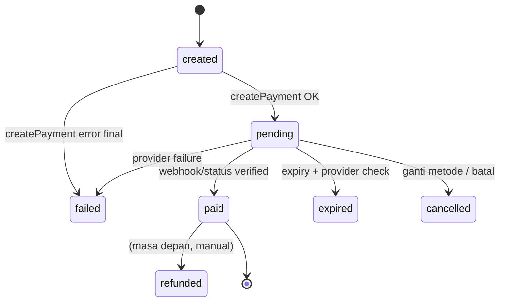

# Payment Architecture

> **Keputusan 10 Nov 2026 (OD-03):** MVP hanya memakai **Midtrans Core API**. Interface `PaymentProvider` tetap dibangun agar provider lain bisa ditambahkan tanpa mengubah alur checkout; bagian Xendit di bawah menjadi referensi untuk fase berikutnya dan **tidak diimplementasikan** di MVP. Fallback antar-provider (BR-16) nonaktif.

## 1. Prinsip
1. Status bayar hanya dari **webhook terverifikasi** atau **query status ke API provider**.
2. Semua pemrosesan **idempoten**; total campaign bertambah sekali per transaksi.
3. Setiap interaksi provider dicatat di `payment_events`.
4. Secret hanya di server (`MIDTRANS_SERVER_KEY`).
5. Hanya metode yang benar-benar didukung provider aktif yang ditampilkan.

## 2. Interface

```ts
// src/lib/payments/types.ts
export type ProviderCode = 'midtrans'; // tambah 'xendit' bila OD-03 dibuka kembali
export type MethodType = 'qris' | 'ewallet' | 'virtual_account' | 'retail' | 'card';
export type PaymentStatus = 'created' | 'pending' | 'paid' | 'expired' | 'failed' | 'cancelled' | 'refunded';

export interface CreatePaymentInput {
  paymentId: string;          // UUID internal → idempotency key / order_id
  transactionCode: string;
  amount: bigint;             // rupiah
  method: { code: string; type: MethodType; providerChannel: string }; // mis. 'bca_va', 'gopay', 'qris'
  customer: { name: string; email: string; phone?: string };
  description: string;
  expiresInMinutes: number;
  successRedirectUrl: string; // hanya untuk UX, bukan bukti bayar
}

export interface PaymentInstruction {
  kind: 'virtual_account' | 'qr' | 'redirect' | 'payment_code';
  bankName?: string;
  vaNumber?: string;
  qrString?: string;          // dirender jadi gambar QR di server/client
  qrImageUrl?: string;
  paymentUrl?: string;        // deeplink / checkout URL e-wallet
  paymentCode?: string;
  expiresAt: Date;
  raw?: Record<string, unknown>; // ter-redaksi
}

export interface CreatePaymentResult { providerRef: string; status: PaymentStatus; instruction: PaymentInstruction; }
export interface StatusResult { providerRef: string; status: PaymentStatus; paidAmount?: bigint; paidAt?: Date; raw: unknown; }
export interface VerifiedWebhook { eventId: string; providerRef: string; orderId: string; status: PaymentStatus; amount: bigint; raw: unknown; }

export interface PaymentProvider {
  readonly code: ProviderCode;
  createPayment(input: CreatePaymentInput): Promise<CreatePaymentResult>;
  getPaymentStatus(ref: { providerRef: string; orderId: string }): Promise<StatusResult>;
  verifyWebhook(req: { headers: Headers; rawBody: string }): Promise<VerifiedWebhook>; // throw bila tidak valid
  getPaymentInstructions(payment: { providerRef: string; instruction: PaymentInstruction }): PaymentInstruction;
  expirePayment(ref: { providerRef: string; orderId: string }): Promise<void>;
}
```

Registry: `getProvider(code)` membaca konfigurasi env; provider tanpa kredensial dianggap **tidak terkonfigurasi** dan metodenya tidak tampil.

## 3. Adapter

> Endpoint & field persis **wajib diverifikasi ulang** terhadap dokumentasi resmi saat Development Step 5 (API provider berevolusi).

### Midtrans (Core API)
| Fungsi | Implementasi |
|---|---|
| createPayment | `POST {base}/v2/charge` dengan `payment_type` (`bank_transfer`, `qris`, `gopay`, `shopeepay`, `echannel` untuk Mandiri), `transaction_details.order_id = payment.id`, `gross_amount`, `custom_expiry` |
| getPaymentStatus | `GET {base}/v2/{order_id}/status` |
| verifyWebhook | `signature_key == SHA512(order_id + status_code + gross_amount + SERVER_KEY)`; lalu **cross-check** `getPaymentStatus` |
| expirePayment | `POST {base}/v2/{order_id}/expire` (fallback `cancel`) |
| Mapping status | `settlement`/`capture(accept)` → paid; `pending` → pending; `expire` → expired; `deny`/`failure` → failed; `cancel` → cancelled; `refund` → refunded |
| Base URL | sandbox `https://api.sandbox.midtrans.com`, prod `https://api.midtrans.com` |

### Xendit (referensi — ditunda, tidak diimplementasikan di MVP)
| Fungsi | Implementasi |
|---|---|
| createPayment | Payments/Payment Request API (versi dipilih saat implementasi) dengan `reference_id = payment.id`, header `Idempotency-key = payment.id`, channel VA/QRIS/e-wallet |
| getPaymentStatus | GET payment request by id |
| verifyWebhook | header `x-callback-token` dibandingkan `XENDIT_WEBHOOK_TOKEN` (timing-safe), lalu cross-check status via API |
| expirePayment | endpoint expire/cancel sesuai channel bila tersedia; bila tidak, cek status dan tandai lokal setelah dipastikan belum dibayar |
| Mapping status | `SUCCEEDED` → paid; `PENDING`/`REQUIRES_ACTION` → pending; `EXPIRED` → expired; `FAILED` → failed; `CANCELED` → cancelled |

## 4. State machine



Status **transaksi** diturunkan dari payment aktif: `created` (belum ada payment), `pending`, `paid`, `expired`, `failed`, `cancelled`, `refunded`.

## 5. Pemrosesan webhook (pseudocode)

```ts
POST /api/webhooks/[provider]
  raw = await req.text()
  event = insert payment_events {provider, raw(redacted), received_at, verification:'pending'}
  try verified = provider.verifyWebhook({headers, raw})
  catch → update event 'rejected'; return 401
  if exists payment_events(provider, event_id=verified.eventId, processed=true) → return 200   // dedup
  db.transaction(async tx => {
    p = SELECT * FROM payments WHERE id = verified.orderId FOR UPDATE
    if !p → mark 'unknown_payment'; return
    if verified.amount !== p.amount → mark 'amount_mismatch'; alert; return
    if !canTransition(p.status, verified.status) → mark 'ignored_transition'; return
    UPDATE payments SET status, paid_at, provider_ref ...
    if verified.status === 'paid':
       updated = UPDATE transactions SET status='paid', paid_at=now(), receipt_no=nextval(...)
                 WHERE id=p.transaction_id AND status <> 'paid' RETURNING *
       if updated: UPDATE campaigns SET collected_amount += amount, donor_count += 1 WHERE id = ...
    mark event processed
  })
  publish QStash notify(event, transactionId)   // dedup key = event:trx:channel
  revalidateTag(`campaign:${slug}`)
  return 200
```

Kunci idempotensi:
- `payment_events UNIQUE(provider_id, provider_event_id)`
- `payments UNIQUE(provider_id, provider_ref)`
- Guard `WHERE status <> 'paid'` + `SELECT ... FOR UPDATE`
- `notification_logs UNIQUE(dedup_key)`

### 5a. Implementasi (P09, T-22) — `src/lib/payments/apply-verified-status.ts`
- `applyVerifiedStatus(tx, {paymentId, status, amount, paidAt, source, eventId, providerRef?})` dipanggil di dalam `getTxDb().transaction()` (driver WebSocket Pool; HTTP driver tidak mendukung transaksi interaktif). `source` ∈ `webhook | expiry_job | reconcile | admin_check`. `eventId` = `payment_events.id` milik event webhook (opsional).
- Urutan: `SELECT ... FROM payments WHERE id = $1 FOR UPDATE` → unknown → nominal (`paid` tanpa nominal juga dianggap `amount_mismatch`) → status sama = `duplicate` → `canTransition` → `UPDATE payments` → turunkan status transaksi.
- `paid`: `UPDATE transactions SET status='paid' ... WHERE id=$1 AND status NOT IN ('paid','refunded') RETURNING` (guard BR-19 diperluas agar transaksi `refunded` tidak kembali paid). Hanya bila baris kembali: `campaigns` += amount/1 dan nomor kuitansi `KW/YYYY/NNNNNN` dari `INSERT INTO receipt_counters ... ON CONFLICT (year) DO UPDATE SET last_seq = last_seq + 1 RETURNING last_seq` (YYYY = tahun `paid_at` Asia/Jakarta; upsert agar tahun baru tidak gagal).
- Status non-paid diturunkan ke transaksi hanya bila transisi transaksi legal (`TRANSACTION_TRANSITIONS`) dan tidak ada attempt lain yang `pending/paid`. Transaksi boleh `expired/failed/cancelled → pending` (attempt baru, BR-11).
- **Anomali** (tidak melempar; ikut ter-commit): `payment_events.result` (`unknown_payment`, `amount_mismatch`, `ignored_transition`) — update event webhook bila `eventId` ada, selain itu baris baru `event_type = internal.<source>`; plus `audit_logs` (actor `system`, entity `payment`) aksi `payment.amount_mismatch`, `payment.unknown_payment`, `payment.ignored_transition`, `payment.needs_review` (uang masuk ke payment yang sudah expired/cancelled atau transaksi sudah paid lewat payment lain — BR-17), dan log JSON terstruktur.
- **Alert admin internal:** hasil fungsi berisi `alert` (`amount_mismatch | paid_after_terminal | unknown_payment`). Pengiriman email admin belum ada (P16): P16 mengirim `alert` ini ke `EMAIL_ADMIN_ALERT` setelah commit dan dapat memindai `audit_logs` aksi `payment.*` sebagai cadangan.
- Hasil `{outcome, changed, becamePaid, newStatus, transactionStatus, campaignId, receiptNo, alert}`; notifikasi & `revalidateTag` hanya bila `becamePaid`, di luar transaksi DB.
- Registry (`registry.ts`): `getProvider(code)` → `null` bila env (`MIDTRANS_SERVER_KEY` + `MIDTRANS_CLIENT_KEY`) tidak lengkap **atau** adapter belum ada (slot Midtrans `create: null` sampai P10). Tidak ada provider palsu di `src/`; `FakeProvider` hanya di `tests/support/`.

## 6. Rekonsiliasi
- **Expiry job** (5 menit) dan **rekonsiliasi harian** memanggil `getPaymentStatus` lalu menggunakan fungsi yang sama `applyVerifiedStatus()` dengan webhook.
- Selisih (provider paid, DB tidak; nominal beda; payment tak dikenal) → `audit_logs` aksi `reconciliation.issue` + email admin.
- Admin dapat menekan "Cek status ke provider" (permission `transactions.reconcile`) — tetap melalui `applyVerifiedStatus()`.

## 7. Instruksi pembayaran
`payment_methods.instructions` (JSONB) menyimpan langkah per kanal (m-banking/ATM/internet banking) yang dapat diedit admin; data dinamis (nomor VA, QR, URL, expiry) berasal dari `payments.instruction` hasil provider. Template instruksi mendukung placeholder `{{va_number}}`, `{{amount}}`, `{{bank_name}}`.

## 8. Metode awal (usulan, dikonfirmasi setelah akun merchant aktif)
| Kode | Tipe | Provider utama | Fallback |
|---|---|---|---|
| qris | QRIS (`payment_type: qris`) | Midtrans | — |
| gopay | e-wallet (`gopay`) | Midtrans | — |
| shopeepay | e-wallet (`shopeepay`) | Midtrans | — |
| bca_va, bni_va, bri_va, permata_va, cimb_va | VA (`bank_transfer` + `bank`) | Midtrans | — |
| mandiri_bill | Mandiri Bill Payment (`echannel`: biller_code + bill_key) | Midtrans | — |

Daftar final mengikuti metode yang **aktif di akun merchant Midtrans** (cek Dashboard → Settings → Payment). OVO/DANA tidak tersedia di MVP.

### Catatan review keamanan P09 (10 Nov 2026)
- **M1 (terbuka):** transisi `paid → refunded` belum mengurangi `collected_amount`/`donor_count`. Wajib dirancang (reversal dalam transaksi DB yang sama, guard `status='paid' RETURNING`) sebelum alur refund dipakai.
- **M2 (aturan):** `applyVerifiedStatus` hanya boleh menerima data dari `provider.verifyWebhook()` atau `provider.getPaymentStatus()`. Tombol admin (`admin_check`) wajib memanggil `getPaymentStatus()` segar di service; status tidak pernah berasal dari input form.
- **L1/L4 (ditutup):** guard `rowCount === 1` pada update payment dan assert nominal transaksi = nominal terverifikasi (beda → rollback).
- **L2/L3 (diterima):** status terminal sesaat saat ada attempt baru (self-heal); pembayaran kedua pada transaksi yang sudah paid tetap `processed` + `alert` — pemanggil wajib memeriksa `alert`.
