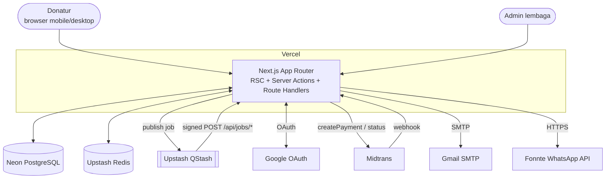
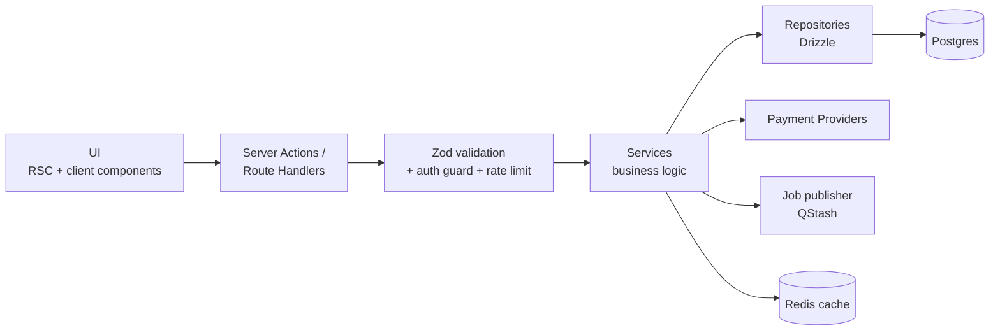
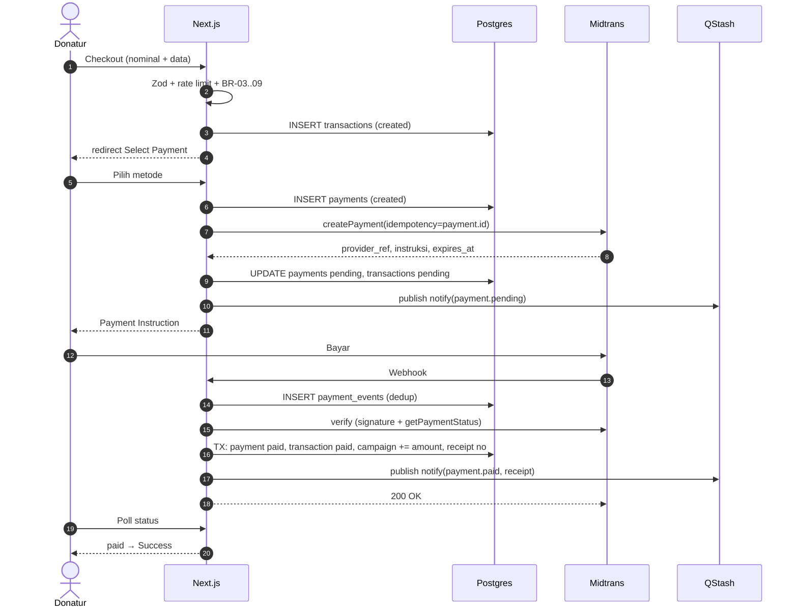

# System Architecture

## 1. Konteks sistem



## 2. Lapisan aplikasi



Aturan: logika bisnis hanya di `services`; `repositories` tanpa aturan bisnis; semua akses data sensitif lewat server.

## 3. Alur donasi end-to-end



## 4. Struktur route (App Router)

```
src/app/
  (public)/page.tsx                         Home
  (public)/campaign/[slug]/page.tsx         Campaign Detail
  (public)/campaign/[slug]/berita/[news]/   News Detail
  (public)/campaign/[slug]/pratinjau/       Pratinjau admin draft (token HMAC 1 jam, noindex)
  (public)/donasi/[slug]/page.tsx           Checkout Form
  (public)/donasi/[slug]/pembayaran/        Select Payment
  (public)/transaksi/[code]/instruksi/      Payment Instruction
  (public)/transaksi/[code]/berhasil/       Success
  (public)/transaksi/[code]/menunggu/       Pending
  (auth)/masuk/page.tsx                     Donor Login
  (donor)/akun/...                          Dashboard, transaksi, profil
  admin/masuk/                              Admin login
  admin/(panel)/                            Dashboard (P20): KPI, grafik harian, performa campaign, transaksi terbaru
  admin/(panel)/campaign/                   P21 daftar (campaigns.read): filter status/kategori/tipe, cari judul (trigram), paginasi
  admin/(panel)/campaign/baru/              P21 editor baru (campaigns.write)
  admin/(panel)/campaign/[id]/              P21 editor + status + penyaluran dana (campaigns.read; aksi per permission)
  admin/(panel)/berita/                     P21 daftar + editor panel (?tulis / ?edit=) (news.write)
  admin/(panel)/{transaksi,donatur,metode-pembayaran,log-pembayaran,audit}/   P22
  admin/(panel)/{template-notifikasi,log-notifikasi}/                       P23
                                            Menu admin (src/lib/admin-auth/admin-nav.ts) difilter permission BR-40.
                                            Rute yang belum dibangun = halaman "Segera hadir" yang dijaga
                                            requireAdmin(permission menu yang sama) — tidak ada tautan 404.
  api/auth/[...nextauth]/  api/webhooks/*  api/jobs/*  api/donor/*  api/admin/*
  api/admin/images/                         P21 upload gambar (POST, requireAdmin + campaigns.write|news.write)
  api/dev-uploads/[file]/                   P21 HANYA APP_ENV=development: sajikan upload adapter lokal (404 di lingkungan lain)
```

## 5. Strategi rendering

| Halaman | Strategi |
|---|---|
| Home, Campaign Detail, News | RSC + ISR (`revalidate` 60 s) + `revalidateTag` saat admin publish / pembayaran paid (total). Implementasi Next 16 `cacheComponents`: query di `src/server/queries/*` memakai `"use cache"` + `cacheLife({ revalidate: 60 })` + `cacheTag('campaigns', 'campaign:{slug}')`; bagian yang membaca `searchParams` (`?kategori=`) di dalam `<Suspense>` (PPR). Statistik (5 menit) & kategori (1 jam) juga di-cache Redis via `cachedJson`; tanpa Upstash di `APP_ENV=development` Redis dilewati, di preview/production env Upstash wajib; error Redis runtime → fail-open + log. |
| Checkout, Select Payment, Instruction, Pending, Success | Dinamis (`no-store`) |
| Donor & Admin | Dinamis, server-only auth |

- Invalidasi admin (P21, `src/server/services/campaign-cache.ts`): setiap mutasi campaign/berita/penyaluran memanggil `revalidateTag('campaigns', {expire: 0})` + `revalidateTag('campaign:{slug}', {expire: 0})` (slug lama & baru) dan mengosongkan memo keberadaan 404 di `src/proxy.ts` untuk slug itu (best effort per instance; instance lain kedaluwarsa ≤ 60 s). Sitemap ikut tag `campaigns`.

## 6. Keputusan arsitektur (ADR ringkas)

| ADR | Keputusan | Alasan |
|---|---|---|
| ADR-01 | Monolit modular Next.js | Tim kecil, satu deploy, server actions |
| ADR-02 | Postgres sebagai sumber kebenaran finansial; Redis hanya cache | Konsistensi & audit |
| ADR-03 | QStash untuk job (bukan Vercel Cron saja) | Retry, signature, delay per pesan |
| ADR-04 | Provider abstraction | Ganti/tambah gateway tanpa ubah checkout |
| ADR-05 | Auth donor (Auth.js) dan admin (custom) dipisah | Isolasi risiko |
| ADR-06 | Uang integer rupiah | Hindari floating point |
| ADR-07 | Notifikasi asinkron | Gagal kirim tidak memengaruhi pembayaran |
