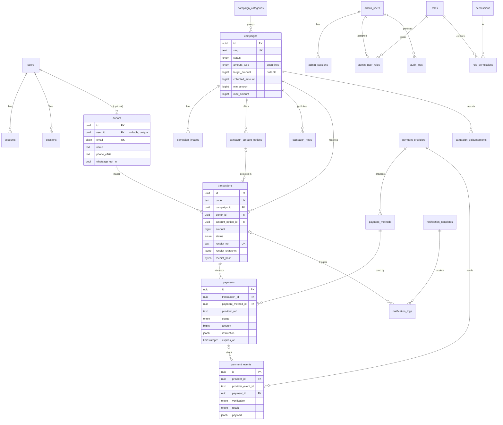

# Entity Relationship Diagram

Database: Neon PostgreSQL 17 · ORM: Drizzle · Konvensi: `snake_case`, PK `uuid` (UUIDv7 dibuat aplikasi), uang `bigint` rupiah, waktu `timestamptz`.

## Perubahan dari daftar tabel master prompt

| Usulan awal | Keputusan | Alasan |
|---|---|---|
| `users` + `donor_profiles` + `donors` | `users` (identitas login Auth.js) + `donors` (profil donatur, termasuk tamu) | `donor_profiles` duplikat `donors`; tamu tidak punya `users` |
| `transaction_items` | **Tidak dibuat** | 1 transaksi = 1 campaign = 1 nominal (BR-11); paket fixed direferensikan langsung `transactions.amount_option_id`. Bisa ditambah bila kelak ada keranjang multi-campaign |
| `roles` | `roles`, `permissions`, `role_permissions`, `admin_user_roles` | RBAC granular |
| (baru) | `accounts`, `sessions`, `verification_tokens` | Wajib untuk Auth.js adapter |
| (baru) | `admin_sessions` | Sesi admin terpisah |
| (baru) | `campaign_amount_options` | Paket fixed & saran nominal open dapat diurutkan/aktif-nonaktif |
| (baru) | `receipt_counters` | Nomor kuitansi berurutan per tahun tanpa celah |
| (baru, OD-06) | `campaign_disbursements` | Rincian penyaluran dana (transparansi) — disetujui PM 10 Nov 2026 |

## Diagram

## Relasi inti: donor ↔ transaksi ↔ payment ↔ campaign

1. **Donor** (login atau tamu) membuat **transaksi** untuk tepat satu **campaign** dengan satu nominal.
2. Transaksi memiliki 1..n **payment** (percobaan). Paling banyak satu payment `pending|paid` (partial unique index).
3. Setiap payment memakai satu **payment method** milik satu **provider**.
4. **Payment events** menyimpan semua webhook/respon provider; dipakai untuk audit & idempotensi.
5. Ketika payment → `paid`, transaksi → `paid` dan `campaigns.collected_amount` bertambah sekali (BR-19). Total selalu dapat diverifikasi ulang: `SUM(transactions.amount WHERE status='paid' AND campaign_id=X)`.
