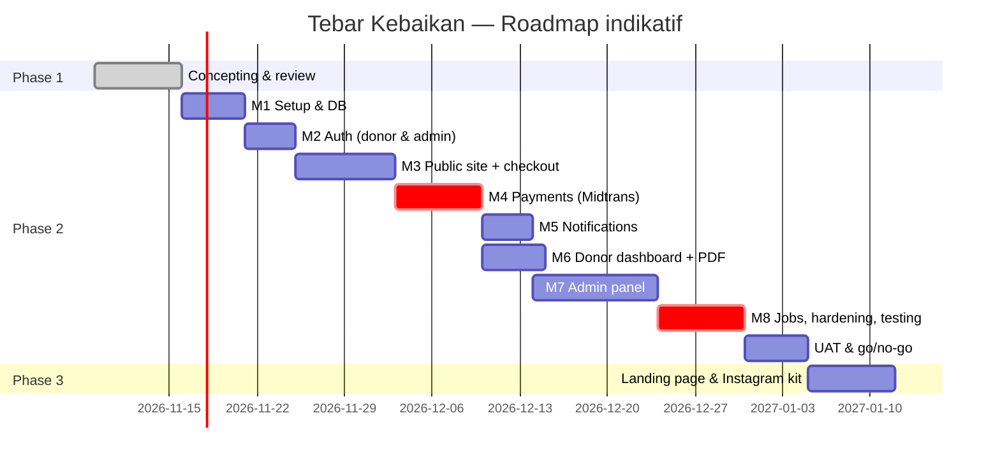

# Roadmap

Estimasi untuk 1 full-stack engineer senior + dukungan agent (Claude). Kalender menyesuaikan tanggal persetujuan Phase 1.

| Milestone | Hasil | Exit criteria |
|---|---|---|
| M1 | Repo, CI, Vercel, Neon, Upstash, skema + seed | App jalan lokal & preview; migrasi dari kosong sukses |
| M2 | Google login, sesi, admin login + TOTP, RBAC | Test otorisasi negatif hijau |
| M3 | 8 halaman publik (tanpa provider nyata: adapter `fake` hanya di test) | E2E checkout sampai Select Payment |
| M4 | Payment abstraction + adapter Midtrans Core API, webhook, idempotensi | Sandbox Midtrans paid/expired/duplikat lulus |
| M5 | Email & WA + template + log | Notifikasi sandbox terkirim, retry teruji |
| M6 | Dashboard donatur, riwayat, PDF | IDOR test hijau |
| M7 | Admin lengkap | AC F-22..F-30 lulus |
| M8 | QStash jobs, rekonsiliasi, perf & security review | Release checklist hijau |
| UAT | Uji PM + lembaga | Go/no-go |

Total Phase 2 indikatif: **±9–11 minggu kalender** (termasuk buffer verifikasi merchant payment gateway yang sering menjadi jalur kritis).
